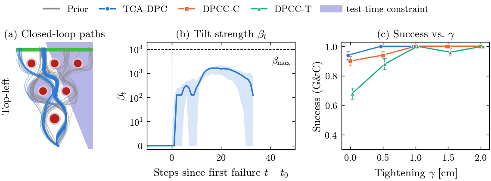

# TCA-DPC: Test-Time Constraint-Aware Diffusion Predictive Control

<p align="center"></p>

Diffusion models can learn multimodal distributions over finite-horizon state-input sequences, providing a way to
generate candidates for predictive control. However, sequences generated by a pretrained model may violate safety
constraints introduced at deployment, for example when obstacles are added or repositioned. Retraining whenever these
constraints change limits the usefulness of learned predictive controllers. We propose *Test-Time Constraint-Aware
Diffusion Predictive Control* (TCA-DPC), an algorithm for adapting the sampling distribution of a pretrained diffusion
controller to newly introduced safety constraints without retraining. We treat the pretrained model as a prior over
finite-horizon sequences and define an adapted distribution through exponential tilting based on a constraint-violation
penalty. The tilt strength is adjusted online using the fraction of generated sequences that fail constraint
verification. We approximately sample the adapted distribution using the Metropolis-adjusted Langevin algorithm in the
Gaussian noise space of the frozen diffusion sampler.

The sampler is in [`tca_dpc/tilt.py`](tca_dpc/tilt.py). It runs on top of [DPCC](https://github.com/ralfroemer99/dpcc)
(submodule `dpcc/`, patched by `setup.sh` with [`patches/dpcc.patch`](patches/dpcc.patch)).

## Installation
```bash
git clone https://github.com/ojasph/tca-dpc && cd tca-dpc
bash setup.sh                 # fetches the dpcc/ and d3il/ submodules, applies the patch
cd dpcc && pip install -r requirements.txt
```
Download the Avoiding dataset into `d3il/environments/dataset/data/avoiding/` following [D3IL](https://github.com/ALRhub/d3il).

## Run
From `dpcc/`, with the pretrained models in `models/` (one folder per seed, 0-4):
```bash
bash scripts/tca_dpc/run_eval.sh config/tca_dpc/tca_dpc.yaml
```
`projection_variants` in the config selects the method: `tilt-tightened` (TCA-DPC), `dpcc-c-tightened`, `dpcc-t-tightened`, `diffuser`.
To retrain the models: `bash scripts/tca_dpc/train_models.sh`, then pass `logs/avoiding-d3il/diffusion/H8_K20_Dmodels.GaussianDiffusion` as the second argument of `run_eval.sh`.

## Reproducing the paper
`scripts/paper_sweeps/make_sweep_v*.py` write the configs of all experiments:
- v1: main results
- v2: baselines
- v3: buffer sweeps
- v4: ablations

Run them with `scripts/run_sweep.sbatch` and analyse the results with `analysis/parse_logs_paper.py` and `analysis/paper_numbers.py`.
The figures are made by `analysis/plot_paper.py`.

## Acknowledgements
Built on [DPCC](https://github.com/ralfroemer99/dpcc) and [Diffuser](https://github.com/jannerm/diffuser); the Avoiding
environment is from [D3IL](https://github.com/ALRhub/d3il). MIT license.
